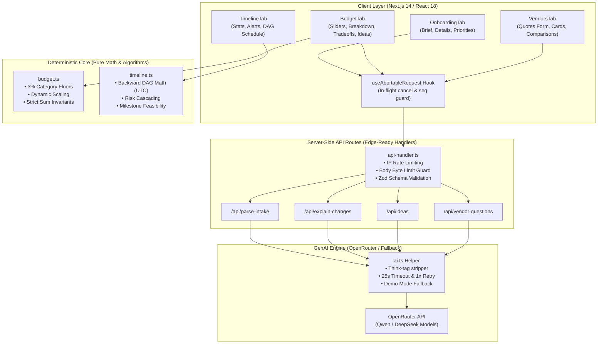

# Event Planner — Intelligent GenAI Planning Assistant

A smart, full-featured event planning platform designed for weddings, birthdays, anniversaries, and community gatherings. Built with Next.js 14, React 18, TypeScript, and OpenRouter AI.

---

## 1. What It Does

Event Planner simplifies high-stakes event coordination into four synchronized modules:

1. **Intelligent Onboarding**:
   - Parses unstructured natural language briefs into structured parameters (occasion, date, budget in INR, guest count, city, and top priorities).
   - Dynamic prioritization (pick up to 3) weights key categories without starving essential services.
   - Clean, zero-persistence fresh start on reload with a prominent **"Start new plan"** reset workflow.

2. **Deterministic Budget & Tradeoff Engine**:
   - Computes weighted allocations across 6 canonical categories (`venue`, `catering`, `decor`, `photography`, `entertainment`, `misc`).
   - Guarantees strict financial invariants: preserves a minimum 3% floor rate per category to prevent vendor starvation.
   - Per-guest scaling for catering: dynamically recalculates costs when guest headcount changes and reports budget surplus with creative upgrade suggestions.
   - Automatically calls server-side AI to generate plain-language tradeoff explanations constrained strictly to provided numbers.

3. **Dependency-Based Timeline Scheduler**:
   - Directed Acyclic Graph (DAG) topological sorting backwards from the event milestone date.
   - Real-time feasibility engine detects overdue tasks against the current date.
   - Cascading risk propagation: cancelling a vendor automatically cascades and marks dependent downstream tasks as "at risk".
   - Warns when an event date has already passed or is invalid.

4. **Vendor Workspace & Coordination Assistant**:
   - Side-by-side quotation comparison with lowest-bid highlights.
   - Essential 7-point booking verification checklist (cancellation policy, advance deposit, overtime rates, GST inclusion, backup plans, payment schedule, written deliverables).
   - Automated AI outreach generator: drafts polite, targeted inquiry messages asking vendors for missing quotation details before committing.

---

## 2. Architecture & Design Decisions

### System Architecture Diagram



### Key Design Decisions

1. **Strict Separation of Math and AI**:
   - All budget sums, percentage allocations, catering scaling, deadline dates, and dependency graphs are calculated purely by deterministic TypeScript algorithms.
   - LLM generation is restricted exclusively to natural language transformation (summarization, parsing suggestions, message drafting). The LLM is never permitted to set, modify, or recalculate budget numbers or timeline dates.
2. **Zero Client-Side Persistent State**:
   - State is stored only in active React memory. Refreshing the browser or clicking "Start new plan" guarantees a 100% clean, predictable state reset without lingering storage corruption.
3. **Concurrency & Race Condition Elimination**:
   - The centralized `useAbortableRequest` hook manages `AbortController` cancellation and monotonic request ID sequence guards. Fast consecutive user interactions cancel superseded in-flight requests and silently ignore out-of-order responses.
4. **Resilient AI Execution & Demo Fallbacks**:
   - Every AI route implements a 25-second timeout, 1 automatic retry on parse errors, and graceful degradation to realistic demo responses when keys are absent or services are degraded. Clear `Live AI` and `Demo mode` badges provide total transparency.

---

## 3. Project Structure

```
event-planner/
├── public/                 # Static assets and showcase media
├── src/
│   ├── app/
│   │   ├── api/
│   │   │   ├── explain-changes/route.ts   # AI tradeoff analysis
│   │   │   ├── ideas/route.ts             # AI personalized enhancements
│   │   │   ├── parse-intake/route.ts      # Natural language brief parsing
│   │   │   └── vendor-questions/route.ts  # Vendor outreach drafter
│   │   ├── error.tsx       # Global React error boundary
│   │   ├── globals.css     # Design tokens and San Francisco typography
│   │   ├── layout.tsx      # Root HTML metadata and CSP tags
│   │   └── page.tsx        # Tab orchestrator, header, and plan reset
│   ├── components/
│   │   ├── budget/         # Modular budget breakdown and tradeoff cards
│   │   │   ├── BudgetBreakdownTable.tsx
│   │   │   ├── BudgetIdeasGrid.tsx
│   │   │   ├── BudgetSlidersCard.tsx
│   │   │   ├── BudgetTradeoffCard.tsx
│   │   │   └── types.ts
│   │   ├── onboarding/     # Modular intake brief and parameter cards
│   │   │   ├── OnboardingBriefCard.tsx
│   │   │   ├── OnboardingDetailsCard.tsx
│   │   │   ├── OnboardingPrioritiesCard.tsx
│   │   │   └── types.ts
│   │   ├── timeline/       # Modular timeline cards, alerts, and tables
│   │   │   ├── TimelineActionAlert.tsx
│   │   │   ├── TimelineStatsCards.tsx
│   │   │   ├── TimelineTasksTable.tsx
│   │   │   └── types.ts
│   │   ├── vendors/        # Modular vendor quote cards and comparisons
│   │   │   ├── VendorComparisonTable.tsx
│   │   │   ├── VendorEmptyState.tsx
│   │   │   ├── VendorQuoteCard.tsx
│   │   │   ├── VendorQuoteForm.tsx
│   │   │   └── types.ts
│   │   ├── icons.tsx       # Accessible SVG icon primitives
│   │   └── ui.tsx          # Design-system cards, buttons, badges, and alerts
│   ├── hooks/
│   │   └── useAbortableRequest.ts  # Shared concurrency & abort controller hook
│   ├── lib/
│   │   ├── ai.ts           # OpenRouter client, think-tag parser, and fallback
│   │   ├── api-handler.ts  # Standardized route validation, IP limits, size checks
│   │   ├── budget.ts       # Deterministic budget allocation & scaling engine
│   │   ├── constants.ts    # Centralized system constants and rate limits
│   │   ├── rate-limit.ts   # Sliding-window IP rate limiter
│   │   └── timeline.ts     # Topological DAG scheduling & feasibility engine
│   └── types/
│       ├── css.d.ts        # CSS module typings
│       └── plan.ts         # Shared event domain models
├── tests/                  # Vitest comprehensive unit and integration suites
│   ├── ai.test.ts          # OpenRouter mocking, think tags, retries, fallbacks
│   ├── api-routes.test.ts  # Rate limits, body size guards, Zod validation
│   ├── budget.test.ts      # Floors, catering scaling, invariants
│   ├── edge-cases.test.ts  # NaN, past dates, zero vendors, negative numbers
│   ├── reset.test.ts       # State purity and fresh reload verification
│   └── timeline.test.ts    # DAG sorting, cascading risks, deadlines
├── .prettierrc             # Standardized code formatting configuration
├── next.config.mjs         # Production CSP security headers and build config
├── package.json            # Scripts and dependencies
└── tsconfig.json           # Strict TypeScript configuration
```

---

## 4. Environment Variables

Configure environment variables in `.env.local` (never committed to version control):

| Variable Name        | Description                                                               |
| :------------------- | :------------------------------------------------------------------------ |
| `OPENROUTER_API_KEY` | OpenRouter API authentication key                                         |
| `OPENROUTER_MODEL`   | OpenRouter model identifier (default: `qwen/qwen3-next-80b-a3b-instruct`) |

_Note: If `OPENROUTER_API_KEY` is omitted, empty, or fails, the application seamlessly enters Demo Mode with realistic pre-written responses. The application never crashes due to AI availability._

---

## 5. Development & Verification Scripts

| Command             | Action                                                       |
| :------------------ | :----------------------------------------------------------- |
| `npm run dev`       | Launch local development server on `http://localhost:3000`   |
| `npm run build`     | Next.js optimized production build                           |
| `npm run start`     | Start production server with security headers active         |
| `npm run lint`      | Run ESLint validation                                        |
| `npm run typecheck` | Run TypeScript strict compiler verification (`tsc --noEmit`) |
| `npm run format`    | Auto-format codebase using Prettier                          |
| `npm test`          | Run complete Vitest suite (all test files)                   |

---

## 6. Assumptions & Constants

1. **Catering Per-Guest Floor**:
   - Assumes a market baseline minimum of ₹500/guest for basic sit-down meal service in Indian urban/semi-urban settings (`MIN_CATERING_COST_PER_GUEST = 500`).
2. **Category Minimum Allocation Floor**:
   - Enforces a 3% floor rate (`MIN_CATEGORY_FLOOR_RATE = 0.03`) and ₹50 absolute floor (`MIN_CATEGORY_FLOOR_INR = 50`) across all 6 categories to ensure no category is zeroed out during severe budget cuts.
3. **Surplus Isolation**:
   - When savings occur (e.g., guest count reduced), funds are reported as an unallocated `surplus` with suggested creative uses rather than silently dumped into miscellaneous expenses.
4. **Lead Times**:
   - Standard lead times follow realistic vendor booking cycles (e.g., Venue 180 days, Caterer 120 days, Photographer 120 days).

---

## 7. Known Limitations

1. **In-Memory Rate Limiting**:
   - Per-IP rate limiting (`src/lib/rate-limit.ts`) uses an in-memory sliding window cache. On multi-instance serverless deployments (such as Vercel Edge/Lambdas), rate limits operate per compute container. For enterprise production, a Redis/Upstash instance is recommended.
2. **Offline AI Calls**:
   - In environments without active internet connectivity, AI requests automatically fall back to deterministic Demo Mode responses.
3. **Multi-Day Itineraries**:
   - The current scheduling model targets single primary event milestones (e.g., wedding reception day, birthday party date) with preceding preparation lead times.

---

## 8. Security & Accessibility

- **Input Sanitization**: All API routes enforce strict Zod schemas with payload size caps ($\le 2000$ bytes) and string length bounds ($\le 1000$ chars).
- **Prompt Injection Defense**: User input is quarantined within `<user_event_brief>` and `<event_context>` XML tags with system-level instruction boundaries.
- **Plain Text Rendering**: AI responses are rendered exclusively as plain text strings (`{text}`); zero usage of `dangerouslySetInnerHTML`.
- **Security Headers & Hardened CSP**: `next.config.mjs` applies strict CSP with `'unsafe-eval'` removed, `connect-src 'self'`, `object-src 'none'`, `X-Frame-Options: DENY`, `X-Content-Type-Options: nosniff`, and `Referrer-Policy: strict-origin-when-cross-origin`.
- **Security Audit & Dependencies**:
  - `postcss` overridden to `^8.5.32` via package.json `overrides` to eliminate transitive CSS parsing advisories.
  - Next.js 14 upstream advisories: Kept on `next@14.2.35` (major upgrades to Next 15/16 prohibited by competition rules); application does not expose untrusted remote image optimizers or object deserialization in Server Actions.
  - ESLint 8 transitives (`glob`, `minimatch`): Dev-time linting dependencies only; excluded from production bundles.
  - Full threat model and mitigations detailed in [SECURITY.md](SECURITY.md).
- **Accessibility (a11y)**:
  - Valid `lang="en"`, skip-to-content keyboard bypass.
  - WAI-ARIA tab pattern (`tablist`, `tab`, `tabpanel`) with full ArrowLeft/ArrowRight keyboard support.
  - Real-time Screen Reader announcements via `LiveRegion` (`role="status"`, `aria-live="polite"`).
  - Status indicators use text labels and pill badges (never color alone).
  - Respects `@media (prefers-reduced-motion: reduce)`.

---

## 9. Quality Gates

The codebase enforces strict automated quality standards:

```bash
# Typecheck TypeScript without emitting output
npm run typecheck

# Lint with ESLint and SonarJS (complexity <= 10, no duplicates, max lines)
npm run lint

# Run all unit, integration, and accessibility tests
npm test

# Run tests with code coverage analysis
npm run test:coverage

# Full automated CI verification gate
npm run check

# Check for unused exports and dependencies
npm run knip
```
